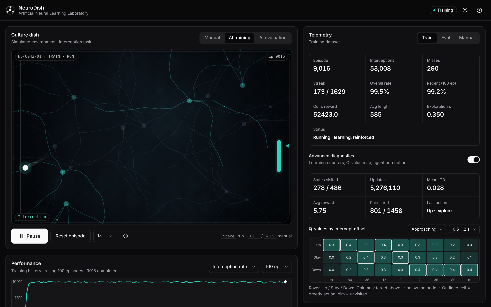
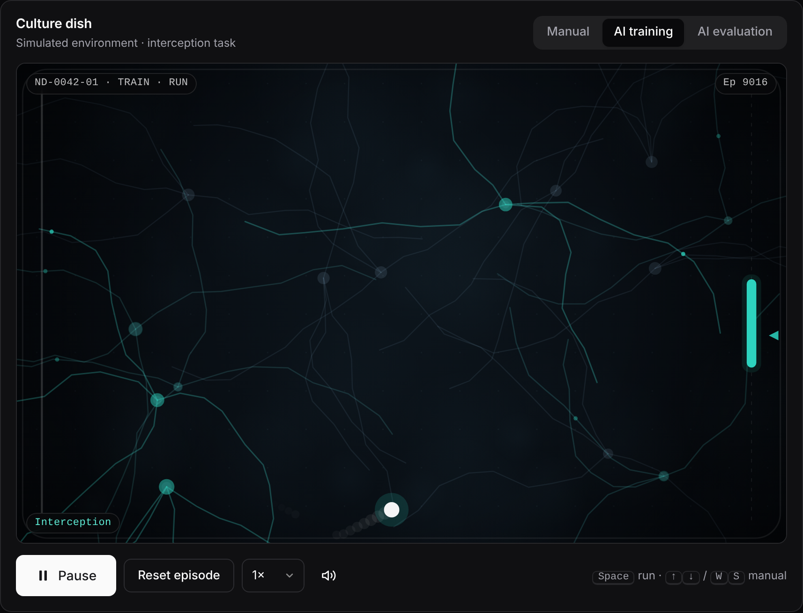
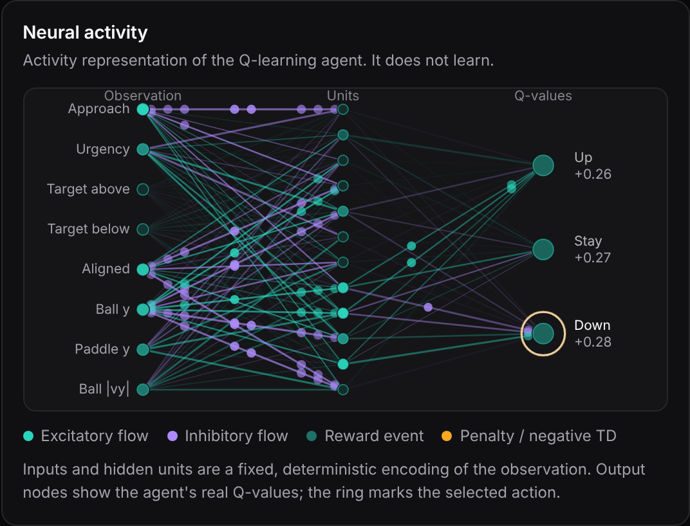
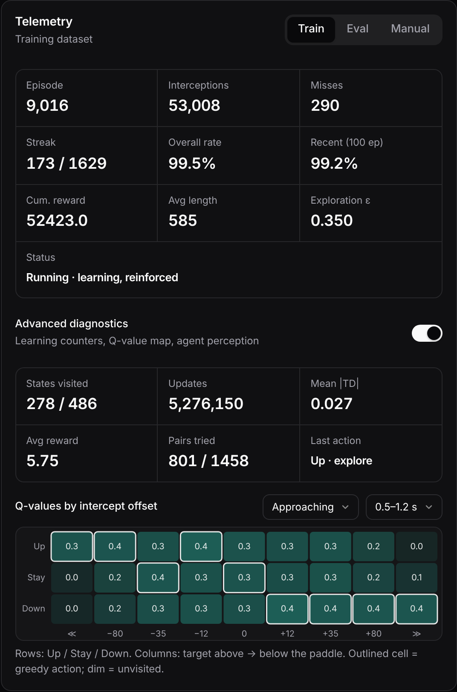
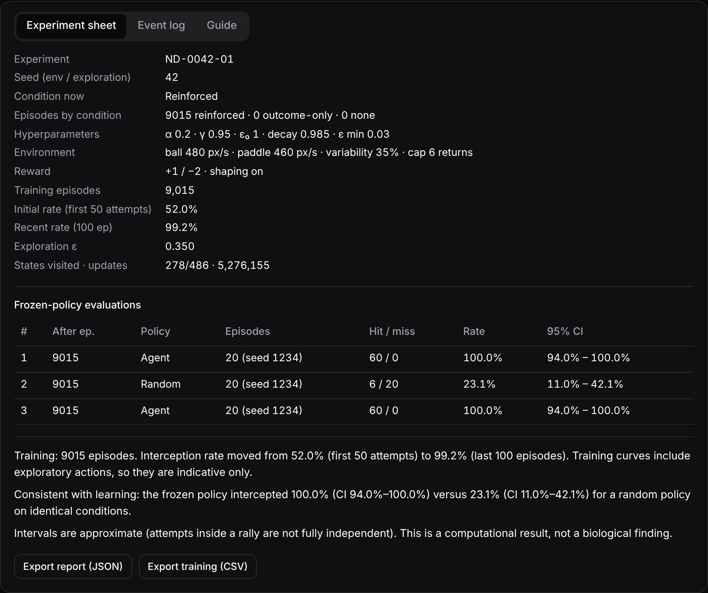
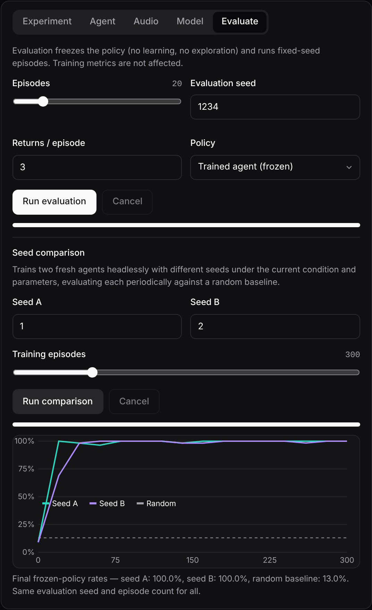
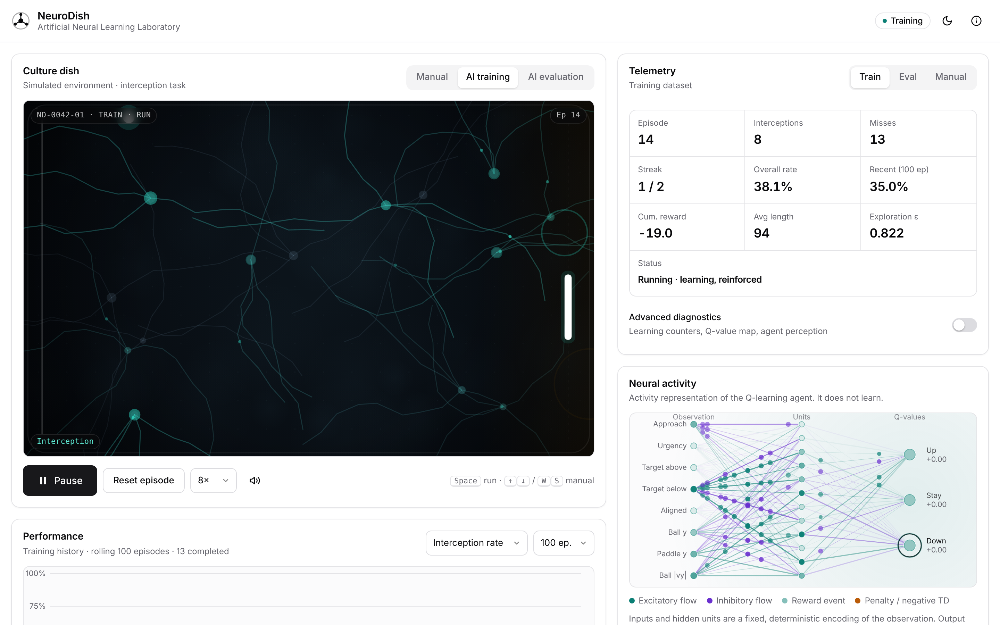
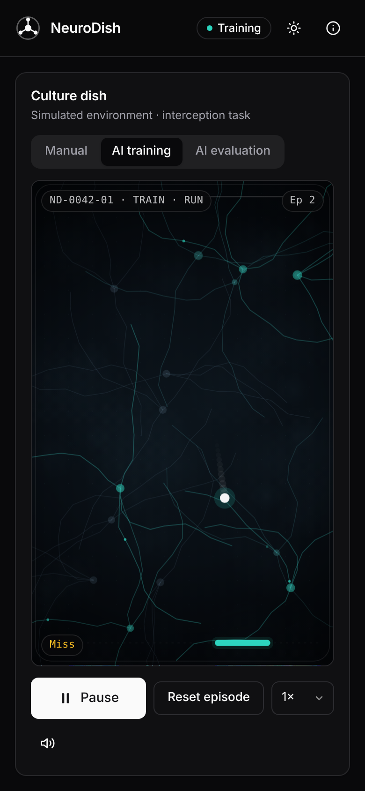

<div align="center">

# NeuroDish

**Artificial Neural Learning Laboratory**

An interactive computational experiment, inspired by neurons-in-a-dish research, in which a reinforcement-learning agent learns to intercept a ball while you watch its internal signals, performance and evidence of learning in real time.


<br>



</div>

<br>

> **Scientific honesty.** NeuroDish is a *computational simulation inspired by* neuroscience. The agent is a tabular Q-learning algorithm; the network drawn next to it is an **activity representation** of that agent. Nothing here is a measurement of, or evidence about, real biological tissue.

## Highlights

- **A real learner, not an animation.** Epsilon-greedy Q-learning with the exact update `Q(s,a) ← Q(s,a) + α[r + γ·max Q(s′,a′) − Q(s,a)]`, terminal states handled correctly, and episodes truncated by the rally cap still bootstrapping.
- **Evidence over vanity metrics.** Frozen-policy evaluation with fixed seeds, a random-policy baseline and 95 % Wilson intervals. The app only states "consistent with learning" when the intervals separate.
- **Instrument-grade visualization.** A culture-dish viewport whose traces respond to the agent's hidden-unit activity, plus a layered activity network driven by the agent's real Q-values and TD error.
- **Experimental conditions.** Reinforced (shaped), outcome-only (sparse) and no reinforcement; reward, penalty, speed and variability are all adjustable.
- **Reproducible.** Seeded PRNG for environment and exploration, a separate evaluation seed, exportable reports and training CSV.
- **Zero setup.** One `index.html`: no build, no backend, no API keys, no external assets.

## Screenshots

<table>
  <tr>
    <td width="50%"><br><sub><b>Culture dish.</b> Top-down experiment viewport; faint traces light up with hidden-unit activity.</sub></td>
    <td width="50%"><br><sub><b>Neural activity.</b> Observation → units → Q-values, with signal pulses and the selected action ringed.</sub></td>
  </tr>
  <tr>
    <td width="50%"><br><sub><b>Telemetry &amp; diagnostics.</b> Counters, exploration, states visited, and a Q-value map by intercept offset.</sub></td>
    <td width="50%"><br><sub><b>Experiment sheet.</b> Configuration, frozen-policy evaluations with confidence intervals, and an evidence-based reading.</sub></td>
  </tr>
  <tr>
    <td width="50%"><br><sub><b>Evaluate &amp; compare.</b> Fixed-seed evaluation and a headless two-seed comparison against a random baseline.</sub></td>
    <td width="50%"><br><sub><b>Light theme.</b> The interface follows your system preference and can be toggled.</sub></td>
  </tr>
</table>

<div align="center">

<br><sub><b>Mobile.</b> The dish switches to a portrait layout with large touch controls.</sub>
</div>

## Quick start

**Online:** enable *Settings → Pages → Deploy from branch → `main` / root*, then open `https://<user>.github.io/cellBrainNN/`.

**Locally:** open `index.html` in any modern browser. No server is required.

1. Press **Start Experiment** and watch the untrained agent (ε = 1 means random exploration).
2. Let it train; follow the rolling interception rate and ε in Telemetry and Performance.
3. Open **Evaluate**, run the *Trained agent (frozen)* and the *Random baseline* on the same seed.
4. Read the **Experiment sheet** for what the evidence supports.
5. Change the condition, or run a **seed comparison**, and repeat.

## How it works

### Environment

A Pong-like task on an 800 × 500 field. The agent's paddle is on the right; the left wall and top/bottom walls reflect the ball. Collisions use a swept test against the paddle face (no tunneling), and the rebound angle depends on impact position and paddle velocity. An **episode** is one rally; it ends at a miss or after a configurable number of returns.

### State, actions, reward

| | |
|---|---|
| **State** (486 discrete) | approach direction × intercept offset (9 signed bins) × time to contact (3) × paddle zone (3) × ball zone (3) |
| **Actions** | Up · Stay · Down |
| **Reward** | `+reward` on interception, `−penalty` on a miss (terminal). Optional shaping of ±0.02 toward the predicted intercept and −0.002 for needless movement, deliberately small so it cannot dominate the task |

### Operating modes

| Mode | Behavior |
|---|---|
| **Manual** | You control the paddle (keyboard, pointer or touch). Metrics are kept separately. Optional, clearly labeled off-policy learning from your moves |
| **AI training** | The agent acts, receives outcomes and updates its Q-table online |
| **AI evaluation** | Policy frozen: no exploration, no updates; fixed seeds; independent metrics |

### Experimental conditions

| Condition | Learning signal |
|---|---|
| **A · Reinforced** | Task reward and penalty plus shaping |
| **B · Outcome-only** | Task reward and penalty, no shaping |
| **C · No reinforcement** | The policy runs but no updates occur; previously learned behavior is not erased |

Audio is rendered for the observer and is **not** an input to the agent, so muting it does not change learning.

### Neural activity panel

Eight normalized observation signals feed twelve units through a fixed, seeded projection; the output nodes show the agent's **actual Q-values** (softmax-scaled), the selected action and the TD-error halo. Reward and penalty events trigger distinct responses. The network visualizes the agent; it is not the learner.

## Controls

| Action | Input |
|---|---|
| Run / pause | `Space` or the primary button |
| Move paddle (manual) | `↑` `↓` / `W` `S` / `←` `→`, pointer drag, on-screen pads |
| Speed | 1× to 32× and Max (bounded work per frame keeps the UI responsive) |
| Save / load model | *Model* tab: browser storage, with overwrite confirmation |
| Export / import | Q-table as JSON (validated on import), report JSON, training CSV, log JSON/CSV |

## Engineering notes

- Fixed 120 Hz physics step with an accumulator and a bounded frame time; rendering uses `requestAnimationFrame` and stops when paused and idle.
- The decision loop (`Rollout`) is pure logic with no DOM access, so the same code powers the live view, the frozen evaluation and the headless seed comparison.
- Statistics, chart history and the event log are bounded; chart history is decimated by a doubling stride.
- Imports are validated (schema, dimensions, finite values, hyperparameter ranges); user text is only written with `textContent`.
- Web Audio synthesis (no audio files), started only after a user gesture, with envelopes to avoid clicks.
- Respects `prefers-reduced-motion` and `prefers-color-scheme`; controls have labels and visible focus states.

```
index.html          # the entire application (HTML + CSS + JS)
docs/screenshots/   # images used in this README
```

Debug hook: append `?debug=1` to the URL to expose the controller as `window.__neurodish`.

## Limitations

- Tabular Q-learning on a small discretized state space is transparent but not a deep network; a trainable neural policy is a natural next step.
- With default settings the agent solves the task quickly. Use *Outcome-only*, higher variability or a faster paddle/ball ratio to see slower, more informative learning curves.
- Confidence intervals are approximate because attempts within one rally are not fully independent.
- Results describe a computational policy under specific reward signals, not biological learning.

## Roadmap

- [ ] Trainable neural policy (e.g. DQN or policy gradient) with real weight visualization
- [ ] Multi-seed statistics with aggregated curves
- [ ] Audio as a true experimental input channel to the agent
